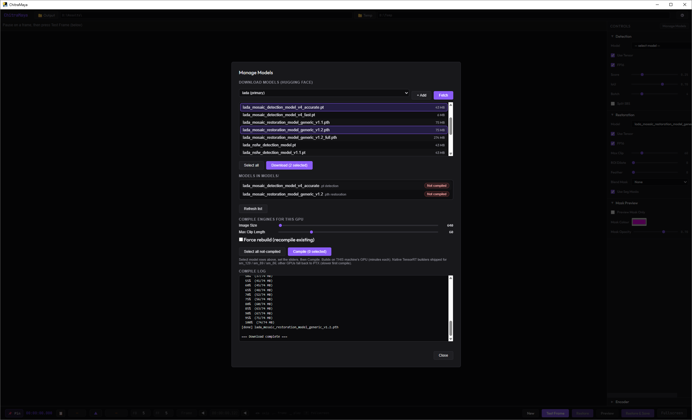
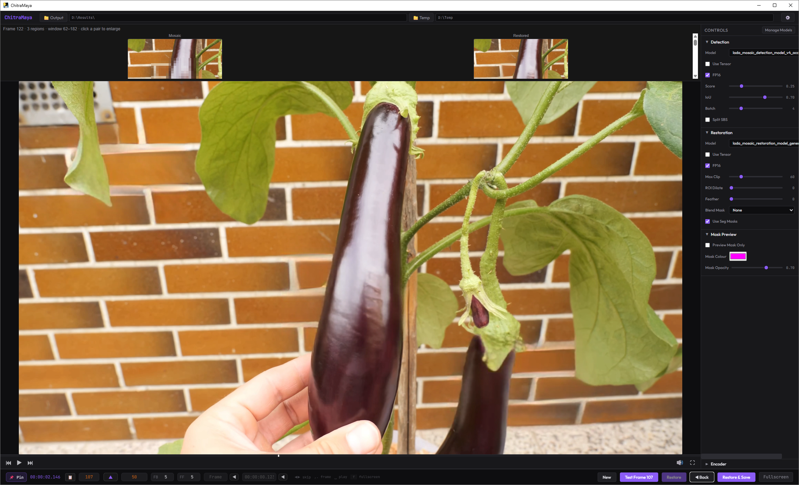

# ChitraMaya

**ChitraMaya is a free, open-source (AGPL-3.0) mosaic restoration tool for Windows that runs on NVIDIA GeForce RTX, AMD Radeon and Intel Arc GPUs.** It finds mosaic-censored regions in video, restores them with the lada / zelefans BasicVSR++ models, and encodes the result on the GPU — with a visual editor to check the restoration on your *actual* frames before spending hours on a full encode, and a folder queue for titles. The NVIDIA edition compiles TensorRT engines for your card; the AMD (ROCm) and Intel Arc (XPU) editions run the same models in PyTorch.

Built for NVIDIA RTX cards first — with **editions for AMD Radeon (ROCm)** and **Intel Arc**, each a separate download (see [the AMD edition](#amd-radeon-rocm-edition--experimental) and [the Intel Arc edition](#intel-arc-xpu-edition--experimental)).

> [!IMPORTANT]
> ### Which edition do I need? One per GPU vendor — they are separate downloads.
>
> | Your GPU | Download from | Installer |
> |---|---|---|
> | **NVIDIA** GeForce RTX (30/40/50-series) | this repository — [Releases](https://github.com/seatv/ChitraMaya/releases) | `ChitraMaya-install.exe` + `.7z.001` + `.7z.002` (all three) |
> | **AMD** Radeon RX 7000 / 9000 (RDNA 3 / 4) | [ChitraMaya-AMD-ROCM](https://github.com/seatv/ChitraMaya-AMD-ROCM/releases) | `ChitraMaya-rocm-install.exe` (one file) |
> | **Intel** Arc (A/B-series, Core Ultra iGPU) | [ChitraMaya-Intel-ARC](https://github.com/seatv/ChitraMaya-Intel-ARC/releases) | `ChitraMaya-xpu-install.exe` (one file) |
>
> From v1.70.00 the wrong edition tells you so: a startup check probes the GPU before anything else loads and, if this edition cannot run here, shows a message naming the GPUs Windows reports and the edition that matches them (and `ChitraMaya.cmd` pauses with the same advice instead of vanishing). `ChitraMaya-cli.exe -self-check` gives the full verdict. The title bar also says which edition is running.


## Why ChitraMaya?

Some restoration tools are batch processors: set parameters, run a full pass, look at the result, repeat. ChitraMaya is built the other way around — as an **interactive editor** that can also batch.

- **Test a single frame instantly.** Park the playhead on any frame and *Test Frame* restores a short window around it, showing each detected region as **Mosaic → Restored** side by side. Dial a setting, test again, watch it change — the loop is seconds, not a full encode. The enlarged view keeps your **last 5 attempts on that frame**, so you can flip between settings variants with one click and pick the winner by eye.
- **Process a whole folder.** *Process Folder* queues every video in a folder with your current settings — models load once, each file runs isolated (one failure can't kill the batch), finished outputs are skipped on re-run, and existing files are never overwritten.
- **Two-stage restoration quality — on by default.** A second stage — **RTX Super-Res** (NVIDIA) or **Real-ESRGAN 4×** (every edition) — upscales restored regions before paste-back so large close-up regions stop going soft, and a **Temporal Stability** stage removes frame-to-frame shimmer from restored regions. From v1.80.00 both are the defaults; any super-resolution model from the community can take the second stage's place (drop it into `models\upscalers\`). See the [Scaling Guide](docs/ScalingGuide.md).
- **Whole-frame upscaling (v1.80.00).** **Output Upscale** brings a 720p or 1080p result to 1440p or 2160p as part of the run, or on its own in **Upscale** mode (decode → scale → encode, no models) — Real-ESRGAN on every edition, RTX Super-Res on NVIDIA. It is a clip-and-overnight feature; the [Scaling Guide](docs/ScalingGuide.md) has the measured costs.
- **Live segment preview.** Mark a segment, preview just that range, and decide whether to commit to a full run before encoding the whole video.
- **Hardware-accelerated throughout.** NVDEC decode, TensorRT-accelerated BasicVSR++ restoration, and NVENC encode — to **HEVC, H.264, or AV1** — keep frames on the GPU end to end. (On AMD Radeon: hardware decode and AMF encode with PyTorch restoration; on Intel Arc: Quick Sync decode and encode with PyTorch restoration — see the edition sections.)
- **A clean windowed app.** No terminal window: console output lives in an in-app Console panel and in `ChitraMaya-console.log` next to the exe. (Terminal fans: `ChitraMaya-cli.exe` is the same app with live console output for headless runs and compiles.)
- **Compiles for your GPU.** No models are shipped. **Manage Models** fetches the standard set with one click (**Get Models**) and, on NVIDIA, compiles TensorRT engines *for your specific card* (**Compile Models**) — the header button says which step is next.
- **Made for VR/SBS content.** Per-eye detection for side-by-side video, a runtime **Image Size** dial for dense high-resolution frames, **VR Projection** for studios whose mosaic arrives warped in the raw frame, and **SBS View**: a projected look-around preview (like a headset, on your desktop) with a draggable wipe to compare original vs restored inside the projection.
- **Add Mosaic.** The inverse operation — pixelate regions to produce shareable SFW clips. Draw rectangles by hand (precise, reliable), or let the app auto-detect regions with a detection model (**experimental** — see the warning below).


## Terms & Conditions

By downloading or using this software, in whole or in part, you agree to use it only for purposes that are lawful in your jurisdiction.

You are solely responsible for what you create with it and for complying with all applicable local, regional, and international laws — including, without limitation, those governing privacy, consent, publicity, defamation, and intellectual property. The authors and contributors of this software accept no responsibility and shall not be held liable for any use of the software or for anything produced with it. If you are unsure whether a use is lawful where you are, consult a legal professional before proceeding.

> [!CAUTION]
> **Automatic mosaic detection is experimental and must not be relied on to censor content.** The "Auto-detect" / censor mode uses a third-party NSFW detection model that does **not** reliably find all explicit content — it will miss regions and whole frames. Do not use it to make content safe for publication, distribution, or any purpose where missed content has consequences. For censoring you can trust, use the **manual draw-rectangles** Add Mosaic, apply the **two-pass leak check** described in the Add Mosaic section, and **review every frame of the output yourself** before sharing. See [Known Issues](#known-issues--not-yet-implemented).

---

## Two ways to run it

- **[For Users](#for-users)** — download the installer, get models, compile, run. No Python, no build tools.
- **[For Developers](#for-developers)** — clone the repo, set up a venv, run from source, or build the installer.

**AMD Radeon or Intel Arc owner?** The NVIDIA instructions below don't apply to you — jump to **[the AMD edition](#amd-radeon-rocm-edition--experimental)** or **[the Intel Arc edition](#intel-arc-xpu-edition--experimental)**.

---

## For Users

### 1. Requirements

- **GPU:** NVIDIA RTX card. Native TensorRT builders ship for **RTX 50-series (Blackwell), 40-series (Ada), and 30-series (Ampere)**. Other cards still work via a slower PTX fallback for the first compile. **AV1 output** additionally requires an RTX 40-series or newer (older cards can decode AV1, but only Ada/Blackwell NVENC can encode it — the app checks and tells you). The optional second-stage upscaler is either **RTX Super-Res** (needs an RTX card with a recent NVIDIA driver) or **Real-ESRGAN 4×** (any GPU, any edition). *(AMD Radeon and Intel Arc cards: see [the AMD edition](#amd-radeon-rocm-edition--experimental) and [the Arc edition](#intel-arc-xpu-edition--experimental) — each is a separate download.)*
- **OS:** Windows 10/11 with an up-to-date NVIDIA driver.
- Nothing else — CUDA, TensorRT, ffmpeg, and Python are all bundled in the installer.

### 2. Download and extract

Grab the latest release from the **[Releases](https://github.com/seatv/ChitraMaya/releases)** page.

> [!CAUTION]
> ### ⚠️ The NVIDIA installer is $${\color{red}THREE}$$ files — you need $${\color{red}ALL\ THREE}$$.
>
> The `.exe` **by itself is not the program**; it is only the unpacker for the
> other two parts. Download **all three** into the **same folder**:
>
> - [ ] `ChitraMaya-install.7z.001`
> - [ ] `ChitraMaya-install.7z.002`
> - [ ] `ChitraMaya-install.exe`
>
> *(The AMD and Intel Arc editions are different: each is **one**
> `*-install.exe` you double-click — see their sections.)*

Run `ChitraMaya-install.exe` — it reassembles the parts and extracts automatically. You'll get a `ChitraMaya` folder containing `ChitraMaya.exe`, `ChitraMaya-cli.exe`, a `models\` folder, and `Compile-All-Engines.ps1`. If the install fails immediately, check that all three downloads completed and are in one folder.

> [!TIP]
> ### Already running ChitraMaya? Updates are small patches now.
> From v1.60.00 on, each release page also carries **patch zips** (under
> 100 MB) so existing users skip the multi-GB re-download. A release may
> offer more than one patch — **pick the one whose "from" version matches
> your install** (`VERSION.txt` next to the exe; e.g. a 1.70.00 install
> takes `ChitraMaya-patch-1.70.00-to-1.80.00.zip`; a 1.70.99-Beta install
> takes the same patch). Extract the patch zip
> anywhere and run
> `powershell -ExecutionPolicy Bypass -File .\Apply-Patch.ps1` — it finds
> your install (or asks), verifies every file it would touch belongs to the
> release the patch was built from (a mismatch refuses cleanly, changing
> nothing), backs up what it replaces, applies, and runs the self-check.
> Your models, compiled engines, and settings are never touched, and
> re-running a patch is safe. After the 1.80.00 patch, **Manage Models**
> turns amber: recompile the detection model once to get the right-sized
> engine (the old one still works until you do).

**Which exe?** `ChitraMaya.exe` is the app — windowed, no terminal; its console output goes to the in-app Console panel and to `ChitraMaya-console.log` next to the exe (the previous run is kept as `ChitraMaya-console.prev.log`). `ChitraMaya-cli.exe` is the same app for **terminal workflows** — headless restores and engine compiles in PowerShell, with live output and progress bars.

### 3. Get the models

No models ship with the app — you add them once, from **Manage Models** (or just drop files into `models\`):

**One click (v1.80.00):** on a fresh install the header button is green and reads **Get Models**. Click it, then **Get standard set** — lada's detection and restoration models and zelefans' VR models are fetched from Hugging Face (or the mainland-China mirror `hf-mirror.com`, with automatic fallback) into `models\`. Anything else you want: pick a source from the dropdown, **Fetch**, select the `.pt` / `.pth` files, **Download**; your own Hugging Face repo URLs go in with **+ Add**.

> Hugging Face throttles anonymous downloads (~1,000 requests/hour per IP) and answers with a 403 once you cross it — easy to hit on a heavy day of testing across machines behind one home IP. If downloads start failing, drop a free "read" token from [huggingface.co/settings/tokens](https://huggingface.co/settings/tokens) into a one-line `hf-token.txt` next to the app (or set the `HF_TOKEN` environment variable) and retry. Failed downloads now name the cause and the fix in the log rather than showing a bare error.



**Manual:** drop any detection `.pt` and restoration `.pth` files straight into the `models\` folder.

*(The Temporal Stability weights are the one exception to "no models ship" — they're tiny, Apache-2.0-licensed, and bundled inside the app, so that feature works out of the box.)*

### 4. Compile engines for your GPU

TensorRT engines are hardware-specific, so they're built on your machine (once per model). When one is missing for your current settings the header button turns amber and reads **Compile Models**:

1. Open **Manage Models**. Downloaded models show as **Not compiled**.
2. Click **Select all not-compiled** (or pick individual rows).
3. Set **Image Size** and **Detection Batch** for the detector (640 / 8 are the defaults — **800 if you mostly restore 4K or VR/SBS content**, see the rule of thumb below). From v1.80.00 the detector engine is compiled with a right-sized profile — batch 1 up to your Detection Batch, frame sizes up to your Image Size — and takes ~0.4 GB of VRAM instead of 1.6–3.1 GB; a run asks for a batch above the engine's profile is clamped to it with a console line. Restoration engines need no size choice: they are **clip-size independent — one compile serves every Max Clip Length**.
4. Click **Compile** and watch the log (selectable, with a **Copy** button for bug reports). This takes a few minutes per model and pins the GPU — that's normal. The selection clears when it finishes.

When it finishes, the badges flip to **Compiled**, the header button goes grey, and the models are ready to use.

> On a 6 GB card, if a restoration compile runs out of memory, that's the one thing to watch — compiling is the most VRAM-hungry step.

### 5. Restore a video

1. Load a video (drag it in or use the file picker). The top bar shows the **full path of the loaded file**, so a long batch session never leaves you guessing which file is on screen.
2. Pick your detection and restoration models in the Control Panel. Turn on **Use Tensor** to use the compiled engines. (Every control has a tooltip — hover to learn what it does.)
3. Park the playhead on a mosaic frame and click **Test Frame** to preview the result on that frame. Adjust settings and test again until it looks right — the enlarged view keeps your last 5 attempts on that frame; flip between them with the ‹ › arrows or jump with the numbered slots (hover a number to see which settings produced it).
4. Use **Restore** / **Restore & Save** to process a segment or the whole video.

**The defaults are the recommended settings (v1.80.00).** A fresh install starts with **Secondary = RTX Super-Res 4×** (NVIDIA; **Real-ESRGAN 4×** on AMD and Intel), **Detection Score 0.20**, **Detection Batch 8**, **Temporal Stability 1**, **Overlap 8 + Crossfade** at Max Clip cuts, and the **Face Swap** blend. Two of those are worth understanding:

- **Secondary.** The restorer works on a fixed-size crop; regions *larger* than that used to be stretched at paste-back and went soft — worst on close-ups and VR. With a secondary on, the restored crop is upscaled first so the final resize shrinks instead of stretching; small regions automatically keep the untouched path. **RTX Super-Res** (NVIDIA, Maxine) gives a smoother look, **Real-ESRGAN 4×** keeps the restorer's texture; neither is more correct — pick by eye with Test Frame. Any community super-resolution model dropped into `models\upscalers\` appears in the dropdown too (a 4× SPAN model is a good one to try — it runs faster than the built-in on AMD and Intel). If RTX Super-Res is selected on a machine without the Maxine runtime, the run falls back to Real-ESRGAN and says so. The [Scaling Guide](docs/ScalingGuide.md) has the measurements.
- **Temporal Stability → 1 (default), 3 for more.** Removes the frame-to-frame shimmer restoration models produce, smoothing each restored region across a 7-frame window only where content agrees — real motion passes through. Only restored pixels are touched. Weights are bundled. 3 may look better and takes longer. On AMD it runs in fp32 (fp16 misbehaves on ROCm); on every edition it checks its own output and a bad window keeps its restored pixels unsmoothed — the run then ends *with warnings* and says why.

> [!IMPORTANT]
> ### Max Clip Length in v1.60: engines are free, frames cost memory
> The old "8 GB VRAM rule" is **retired**. As of v1.60.00, TensorRT
> restoration engines are **clip-size independent** — they no longer reserve
> VRAM for a compiled clip size, one compile serves every setting, and the
> Max Clip dial is free from **30 to 720** on the Tensor path. In the field
> this freed ~1.6 GB of VRAM on an 8 GB card versus v1.50, and Max Clip
> **300 at 4K with the full quality stack completes on 8 GB cards**.
>
> What long clips *do* cost now is **memory for the frames in flight**: the
> encoder must hold back roughly Max-Clip frames behind unfinished clips, and
> at 4K that is ~24 MB per frame — held in VRAM when it fits, otherwise in
> **system RAM**. High Max Clip x high resolution x high framerate is a real
> RAM bill (4K/60 at MCL 300 ≈ 8 GB). The console now prints a **RAM plan**
> at startup — if your Max Clip doesn't safely fit your machine, it says so
> before the run and names the largest value that does — and a **RAM guard**
> pauses decode-ahead mid-run rather than letting the machine run out.
> Heed both lines. (Encoder advice is unchanged: **preset P5 on 8 GB cards**.)

A few more things worth knowing before a full run:

- **Max Clip Length is a pure runtime dial (v1.60).** Restoration engines are clip-size independent, so any Max Clip from 30 to 720 runs on the same compiled files. Longer clips give better temporal stability but hold more frames in memory — see the RAM-plan box above. Engines compiled under v1.50 are recognized as-is (no recompile); only much older sets load with a cap and a recompile hint.
- **Full-clip restoration on the PyTorch path (v1.50.00).** With **Use Tensor** off, the Max Clip dial unlocks up to **600 frames** and the restorer propagates detail across the whole window in one pass — the dial *is* the temporal window there, limited only by memory. If a long window doesn't fit, add `"restoreChunkFrames": 32` to `ChitraMaya-config.json` (or `--restore-chunk-frames 32`) to restore the old chunked behavior.
- **Two copies at once is fine.** Launching a second instance automatically picks the next port (the console says so) and writes its own `ChitraMaya-console-<pid>.log`, so parallel sessions don't fight over one log file.
- **VRAM pre-flight — now a dialog, before the run (v1.80).** When you press **Restore & Save** (or start a **Process Folder** batch), ChitraMaya estimates the run's working set from the frame size and the panel (scene crop buffers, detector, decoder, paste-back, the Async queue) against the VRAM that will be free once the models are resident — the models' footprint is what this card measured on its last run of the same shape (kept in `vram-ledger.json` next to the app), or an edition table before that first run, and the dialog says which. If it does not fit, you get three choices: **Apply levers and run** sets the panel controls that fit (Crop Cap to the value that does, Async Encode off) in plain view and starts; **Run anyway** keeps your settings; **Cancel**. The same estimate is printed in the console after the models load (`[VRAM] preflight ...`), now from the same arithmetic, and the ledger lines during the run are the truth it is graded against. For a folder, the largest file in the plan decides. Heed it, especially on 8 GB cards at 4K: a 4K60 title with Crop Cap off needs ~5.5 GB of scene buffers alone. The pre-v1.80 preflight also covers **system RAM** when the host frame store is used (see the Max Clip box above).
- **Async Encode is off by default.** Synchronous encoding is the dependable default and saves ~500–600 MB of VRAM at 4K. If your card has headroom, tick **Async Encode** in the Encoder panel to overlap encode with restoration for a faster run.
- **Output codec.** The Encoder panel offers **HEVC** (default), **H.264**, and **AV1** (RTX 40-series or newer). Your **QP** setting always uses the familiar HEVC 0–51 scale; for AV1 the app maps it internally to AV1's finer quantizer scale (the log shows the mapping), so QP 18 means the same quality intent regardless of codec. AV1 outputs are automatically post-processed so they seek correctly in every player (a hardware-encoder quirk ChitraMaya repairs at packaging time). The **Preset** dropdown offers the full P1 (fastest) to P7 (best) ladder — on 8 GB cards stay at **P5 or below**.
- **Outputs never overwrite.** If the output name already exists, the new file gets a `-2`, `-3`, … suffix and the log says so.
- **Stall protection.** A watchdog monitors long runs and calls out a stalled pipeline instead of letting it sit silently. On eGPU setups it also warns if the PCIe link is running below its trained speed *under load* — an early warning for VRAM-paging trouble — and (v1.60) summarizes benign link "flapping" into one line a minute instead of alarm storms, while a down-train that does *not* recover still alarms in full. The stall threshold is configurable: add `"watchdogStallSeconds": 300` to `ChitraMaya-config.json` (next to the exe) if the default 120 seconds is too eager for your hardware.
- **Stream captures (MPEG-TS) are remuxed before decode (v1.61).** Files ripped from streaming sites are usually MPEG-TS streams (often named `.mkv`); the GPU decode path silently dropped ~5 seconds at the head of such files on earlier releases, producing a constant audio desync. ChitraMaya now detects TS sources and losslessly remuxes them to a temporary MP4 first (stream copy, no quality change). You'll see a `<name>.cm120-tsremux.mp4` appear next to the source (or in the system temp folder) while the run is active — it is roughly source-sized, is deleted when the run finishes, and is reused if you re-run the same file. **If a pre-1.61 output from a stream capture ever drifted out of sync, re-run the source file** — old outputs cannot be repaired after the fact.
- **Sources with a "30 fps plus a dropped frame every 33 s" timeline no longer drift (v1.80).** Some muxers stamp a 29.97 fps title at exactly 30.000 fps and skip one frame every ~990 to keep the average; the gap filler correctly held a frame at each skip, but the output was then stamped at the *average* rate, counting every skip twice, and the audio drifted by about 6.6 s over a 1h48m title (v1.61–1.70). The finalize now derives the container rate from the encoded-vs-source frame counts (the console line `[Encoder] gap-fill: ... output rate 194773/6499 -> 30`, and `effective.output_rate` in the run report), so the video keeps the source's duration. Outputs made on 1.61–1.70 from such sources cannot be repaired; re-run the source.
- **Failed runs report what survived (v1.60).** A hard mid-run error no longer masquerades as total loss: everything encoded before the failure is flushed and remuxed as always, and the app now says **"PARTIAL: encoded M of N frames"** — the output file is playable up to that point, and the console names it.
- **The encoder cannot fail silently, and slow disks get their time (v1.61).** If the hardware encode session dies mid-run (it happens — drivers, power events), the app now aborts loudly within seconds instead of "encoding" nothing for hours; your already-encoded frames are preserved in a raw bitstream next to a ready-made `*-RECOVER.ps1` script, and the end-of-run log reports the bitstream size so a byteless success is impossible. The final packaging step is likewise now supervised by **disk progress** rather than a wall-clock timeout — a slow hard drive gets as long as it needs, a truly stuck process is still killed within minutes, and a failed finalize removes its half-written output (the raw bitstream + recovery script remain your salvage).
- **Saved configurations (v1.70.00).** The ⚙️ menu's **Save / manage configurations…** stores the complete current settings — every control plus the output and temp folders — under a name; the names then appear in the ⚙️ menu and one click loads one and makes it the active configuration (it survives a restart). Files live in `presets\` next to the exe and can be copied between machines. Save Settings / Load Settings / Reset Defaults still work on the single active configuration.
- **Honest progress in the console (v1.70.00).** Every 500 completed frames the console prints `[Pipeline] frame N/M  avg X fps  elapsed  ETA` — the true average since the start, not the instantaneous rate the progress bar shows between clip flushes — so a log tells you how a long run really went.
- **Runs that need your attention say so (v1.80.00).** A run whose restorer or stabilizer refused frames, or whose decoder handed over damaged frames that were repaired, ends `DONE WITH WARNINGS` in the console with the reasons; the Complete panel reads **Complete — with N warnings**; the run report carries them. A clean run says `Complete!` as before.
- **The run report `<name>.run.json` (v1.80.00)** sits beside every output (or in the Temp folder, or off — the **Run Files** switch): what was asked vs what actually ran (which decoder, encoder, scaler, precision), timings per stage, the VRAM ledger, detection and restoration counts, and per-frame lists (frames the detector bridged, frames the guards touched, frames the **residual scan** still found mosaic on). When something looks wrong, this file is what to send. The **🏷️ Suffix** field in the header sets the output name's suffix.
- **Output Upscale and the Upscale mode (v1.80.00).** See the [Scaling Guide](docs/ScalingGuide.md) — whole-frame upscaling is a clip feature or an overnight one, and the guide has the hours-per-hour numbers per card so you can decide before you start.
- **Saved configurations gained a built-in: VR 4K** (⚙️ menu) — Image Size 800, Max Clip 180, Split SBS on, one click; your own saved configurations sit next to it.
- **The finished file is verified before it is called done, and the salvage outlives the finalize (v1.80).** The moment the final remux returns, the output is flushed to disk (fsync) and read back — index present, video stream, the exact frame count the run encoded — before the console prints Done. The raw bitstream, its `*-RECOVER.ps1` script and the audio sidecar then stay on disk until the run's very last step (after the residual scan and the run report), where the output is read back once more and only then are they removed. A power cut anywhere in that window costs a 30-second re-mux, never a re-run. If a file ever reads back wrong, both the output and the salvage are kept and the console says so. Every 500-frame checkpoint line (and `gpu_checkpoints[]` in the run report) now also carries the torch split — `torch allocated/reserved` — next to the driver's VRAM reading, so a card that reads full for hours can be told apart: a wide split is torch's cache holding what the natives will ask for next, a narrow one is the real working set.
- **The system stays awake during runs.** ChitraMaya holds off the idle-sleep timer while processing (the display may still turn off), then releases it — overnight runs no longer die to a power plan.




### 6. Process a whole folder

**Process Folder** (Alternate Execution Modes) runs your current settings over every video in a folder:

1. Pick the folder (paths pasted from Explorer work, quotes and all), optionally recursive, and choose the output location and suffix.
2. The queue modal shows every file, tells you which will be **skipped and why** (usually: output already exists — that's your resume mechanism), and processes the rest one by one with a live status and elapsed clock per file.
3. Models load once and stay warm for the whole batch. Each file runs isolated — a failure on one file (even a GPU hang; the watchdog catches it) is logged and the batch moves on.
4. Everything the batch did is in the console log, including a per-file summary at the end.

Headless: pass a **folder** to `--input`, with `--batch-video-extensions` and `--batch-skip-existing` to control selection.

### 7. VR / SBS content — the dials that matter

For side-by-side (SBS) VR video, enable **Split SBS** in Detection so each eye is detected at full resolution. Then two more dials decide how good the result gets:

**Image Size (Detection).** The detector's input resolution, adjustable at runtime (640–960, steps of 32). On 4K-and-up VR frames the default 640 downscales too aggressively and can miss small or faint mosaics; **800 is the field-tested sweet spot for ≥4K VR/SBS** (640 missed frames in our tests; 800 and 960 caught everything, and 960 fragments clips without adding catches). **Rule of thumb: 800 for 4K and VR/SBS, 640 for 1080p** — measured on a 4K clip, 800 cost 15 % more detection time and changed nothing at all in the detections at 1080p-class mosaic sizes; it earns its keep on far-field VR mosaics. With **Use Tensor** on, the compiled engine must match this size — if it doesn't, a modal at submit time offers to use the engine's size, continue on PyTorch, or open Manage Models (the built-in **VR 4K** configuration sets 800 and its companions in one click).

**VR Projection (Detection).** Some VR studios apply the mosaic to the raw video frame; others apply it in *viewing* space, so it looks square in a headset but arrives warped and trapezoidal in the raw frame — a pattern the detection and restoration models were never trained on and handle poorly. The **VR Projection** dropdown (requires Split SBS) fixes the second kind: with **Fisheye** selected, each eye is warped so those blocks become square again, detection and restoration run in that space, and only the restored regions are warped back onto the untouched original frames — background pixels are never resampled.

*Which setting for which video?* Open the video in any flat player (PotPlayer, VLC — no VR mode) and look at the mosaic:

- Blocks form a clean, even grid of **squares** → leave VR Projection **Off**. (Warping this content would hurt.)
- Blocks look **warped** — trapezoidal cells, rows that bow or fan out, especially away from the center → set VR Projection to **Fisheye**.

> [!IMPORTANT]
> On warped-mosaic content with projection Off, the run statistics can look perfect (every frame "detected and restored") while the output still shows mosaic — the models latch onto the warped blocks but cannot actually reconstruct them. **Judge quality with your eyes, not the stats:** use **Test Frame** on a mosaic-heavy frame with projection Off vs Fisheye and compare.

> VR bonus: the RTX Super-Res secondary is at its most valuable on VR content — close-up regions there are routinely far larger than the restorer's native crop.

**8K VR on cards before RTX 50-series (v1.61):** H.264 sources wider than 4096 px (8K VR is 4320) exceed NVDEC's decode limit on everything before Blackwell, so ChitraMaya automatically falls back to CPU decode for those files — the console says so at startup. From v1.61.00 the full VR pipeline (projection, restoration, paste-back) works correctly on that fallback path; expect it to be much slower than NVDEC, which is a hardware limit rather than a setting.

### 8. Compare in 3D — SBS View

For side-by-side VR content, the flat player shows two distorted fisheye-looking halves. **SBS View** (the button next to the volume control) projects the video the way a headset would — a natural look-around view — and lets you compare the original against your restored output side by side *inside* that projection.

It helps to understand the two independent choices in the top bar, because they answer different questions:

- **Eye (L / R)** — *which eye's image am I inspecting?* SBS video carries two pictures; this picks one. Your choice applies to everything on screen at once.
- **View (Original / Restored / Wipe)** — *which video fills the screen?* **Original** is the loaded video, **Restored** is your most recent output (run a restore, or Add Mosaic, first — until then only Original is available), and **Wipe** shows both at once, split by a draggable divider: **original on the left of the divider, restored on the right**. The divider splits the two *videos*, not the two eyes.

So "Eye = L, View = Wipe" means: show the left eye's picture, original left of the divider, restored right of it. Drag the divider across a restored region and watch it flip between mosaic and clean — that's the money shot.

Everything else in one place:

- **Look around:** drag with the mouse. **Zoom:** mouse wheel (FOV 30–110). **Reset view** or `0` recenters.
- **Playback:** both videos play together, frame-locked. Space = play/pause; `«  ‹  ›  »` buttons (or ←/→ arrows) skip by your configured skip amounts; `,` / `.` step a single frame; `m` unmutes (audio comes from the restored side). The `fN` counter in the time display is the current frame number.
- **Speed** (0.1×–1×): slow motion for close inspection — and if a very large original struggles to keep up with the restored side, a slower speed lets it stay in sync.
- **Offset:** aligns the clocks when the restored side is a *segment* preview (its 0:00 is the segment start). Auto-filled; you rarely need to touch it.
- **Esc** closes and frees the viewer's decoders.

> SBS View is a desktop editing aid, not a headset mode — for viewing in VR, open the output file in your usual VR player. It currently assumes equirect-180 side-by-side (left|right) content. (VR Projection affects *restoration*; a matching projection selector for this viewer is planned.)

### 9. Add Mosaic — make SFW clips

The inverse of restoration: pixelate regions and save, for producing shareable, safe-for-work clips (this project's own demo material is made with it). There are two ways to place the mosaic — a **reliable manual** way and an **experimental automatic** way.

**Manual (reliable) — draw the rectangles.**

1. Load a video; optionally mark a segment to limit the scope.
2. Click the **Add Mosaic** button. The player pauses and a crosshair appears — **drag rectangles directly on the video** (up to three). Each shows its size and a ✕ to remove it. You can still scrub the timeline to a better frame while drawing.
3. For SBS video (with **Split SBS** on), draw on *either* eye — a dashed ghost mirrors the rectangle to the other eye at the same per-eye position, and both eyes get mosaiced.
4. **Done** opens a dialog with the exact pixel coordinates for fine-tuning (**Draw again** goes back to the video with your rectangles intact). Set **Block** for the mosaic cell size (16 is the classic look).
5. **Add & Save** encodes to `<name>-mosaic.mp4` (or `-mosaic-seg.mp4` for a segment) in your output folder. The result becomes the preview — open **SBS View** and wipe-compare original vs censored to verify placement in both eyes.

**Automatic (experimental) — let a model find the regions.**

> [!CAUTION]
> **This is experimental and will miss content. Do not use it to censor anything you intend to share.** It depends on a third-party NSFW detection model whose accuracy is limited — it misses regions and whole frames, and it is *not* production-grade. Treat any automatic result as a rough draft that **you must review frame by frame**, and fix by hand. When it matters, use the manual method above.

Auto mode reuses the detection pipeline: pick a detection model (e.g. an NSFW detector) as the **Detection** model, then under **Alternate Execution Modes** in the Control Panel tick **Add Mosaic** and set **Block**. Now **Test Frame** shows each detected region as **Original → Censored** (the fast way to see what the model catches and misses on a given frame), **Restore** previews a censored segment, and **Restore & Save** writes `<name>-censored.mp4`. A detection model is all it needs — no restoration model.

**Field-proven technique #1 — max-recall settings.** For censoring, over-coverage is safe and a miss is not. Run detection with **Score 0.05** and **IoU 1.0**. The IoU dial controls how aggressively overlapping candidate boxes are merged — it is *not* a sensitivity dial — and at 1.0 every candidate region is kept, which is exactly the right bias when missing something has consequences.

**Field-proven technique #2 — the two-pass leak check.** After censoring, run the same detector **over the censored output** (Test Frame or a preview pass). Any frame where it still detects something is a leak candidate — go patch those frames with manual rectangles and re-save. This converts "scrub the whole file slowly and hope" into a short, targeted checklist. It is not a guarantee — a final review with your own eyes (playback-speed control + SBS View wipe) is still mandatory before sharing anything.

---

## AMD Radeon (ROCm) Edition — EXPERIMENTAL

> [!CAUTION]
> **Early field coverage, now with in-house hardware.** From v1.70.00 the
> AMD edition is tested on our own **RX 9060 XT 16 GB** (RDNA 4) before
> release; field reports cover a small number of other machines. It may
> work well on your card; it may not. Use with caution and please report
> what you find.

The AMD edition is a **separate download** — a single **`ChitraMaya-rocm-install.exe`** from **[ChitraMaya-AMD-ROCM](https://github.com/seatv/ChitraMaya-AMD-ROCM/releases)**: double-click, pick a **new** folder, and run `ChitraMaya.cmd` from the extracted folder. Do not mix it with the NVIDIA install, and do not extract a new version over an old one.

> [!IMPORTANT]
> ### v1.80.00: Temporal Stability works on AMD now, and damaged frames from the hardware decoder are caught.
> Every previous AMD release ran the temporal stabilizer in half precision,
> which on ROCm returns garbage windows — black rectangles and waviness in
> restored regions on some runs. It now runs in fp32 here and checks every
> window it produces. Separately, the D3D11VA hardware-decode path can hand
> over a frame that was never finished (black from a row down, or green /
> magenta); a **decode guard** completes such frames from the frame before,
> reports them, and **Hardware Decode = Off** avoids them outright — see the
> known issue below. If earlier AMD outputs of yours had the odd black or
> green frame, or wavy restored regions: these were why.

**How it differs from the NVIDIA edition:**

- **Driver: AMD Software Adrenalin 26.2.2 or newer.** Check with GPU-Z or AMD Software. If Windows installed only a basic display adapter, install Adrenalin from amd.com (Windows Update sometimes delivers the full package by itself, sometimes not). Earlier drivers lack the runtime the bundled PyTorch ROCm stack needs.
- **Supported cards: RDNA 3 and RDNA 4** (RX 7000 / RX 9000 series) — ROCm on Windows does not support older Radeons, and no driver version changes that.
- **No engine compiling.** TensorRT does not exist here — models run directly in PyTorch (with the full-clip temporal window). Manage Models still downloads the `.pt`/`.pth` checkpoints; there is simply no compile step.
- **The first run after installing into a new folder is slow, once.** The ROCm math library compiles GPU kernels the first time it meets each model and clip size and caches them in `miopen-cache` next to the exe (v1.70.00 pins the cache there so it survives updates; copy that folder from an old install into a new one to skip the wait). The first clip of the first run can sit for a few minutes with no visible progress — the console says so at start — and the stall watchdog may print a stack dump while it waits: a diagnosis, not a crash. Later runs, and later clips of the same size, start immediately.
- **Detection FP16 is off on this edition, deliberately.** Measured on the 9060 XT: FP16 detection finds mosaic in the first few frames and then nothing. The pipeline runs detection in FP32 regardless of the toggle (the checkbox is greyed with the reason). **Restoration FP16 works, its output is clean, and it is about 15 % faster** — your choice. Temporal Stability runs in fp32 here regardless (the console says so).
- **Which files to download:** in Manage Models, fetch one detection model (a `.pt` file — `lada_mosaic_detection_model_v2.pt` is the proven starting point) and one restoration model (a `.pth` file — `lada_mosaic_restoration_model_generic_v1.2.pth`). Those two are all a basic restore needs.
- **ffmpeg does decode and encode:** D3D11VA hardware decode and AMF hardware encode (HEVC, H.264, AV1 on RDNA 3+). Decoded frames travel back to the app through a pipe near 30 fps at 1080p60 and ~10 fps at 4K — on 1080p titles it hides behind the restorer; at 4K it is the slow stage. **Hardware Decode** (Restoration panel, under Frame Store) switches to CPU decode; see the known issue below for why you might. `ChitraMaya-cli.exe -probe-decode --input <clip>` measures the layers of that path on your machine.
- **Secondary upscaler: Real-ESRGAN 4× by default;** any community super-resolution model in `models\upscalers\` can take its place — a 4× SPAN model runs about 9 % faster than the built-in here. RTX Super-Res and the PCIe monitor are NVIDIA-only and say so. **Temporal Stability works** (fp32, checked per window; on by default at strength 1).
- **Whole-frame upscaling** (Output Upscale / Upscale mode) runs Real-ESRGAN or a custom model over every frame: a 720p title to 2160p took 10 hours on the 9060 XT, a 1080p frame to 2160p costs ~180 ms — hours per hour of video. Clips, or overnight. See the [Scaling Guide](docs/ScalingGuide.md).
- Everything else — the editor, Test Frame, Process Folder, Add Mosaic, SBS View, the watchdog, keep-awake, crash hardening — is the same product.

**What to expect (RX 9060 XT 16 GB, ROCm 7.2, measured):** a 2h41m 1080p60 feature (the same title as every row in our NVIDIA benchmarks) restored in **6h51m–7h06m = 0.38–0.39× realtime** (v1.70, detection v2 @640, Max Clip 90, FP32, HEVC via AMF). Put plainly: **in PyTorch a 9060 XT runs like an RTX 4060 in PyTorch** (6h44m on that title); the NVIDIA edition's TensorRT path is 2–3× faster than any PyTorch path, ours included (a 3060 12 GB: 3h11m; a 5060 Ti: 2h31m). On v1.80.00 with the full quality stack — Temporal Stability 3, Real-ESRGAN, Max Clip 180 — a 17 s 1080p test cut takes **42–51 s** (11.8 fps in FP32, 13.6 in FP16, 14.3 with a SPAN secondary); a dense 1080p60 clip of 7,883 frames, **13m34s**; a 720p title restored *and* upscaled to 2160p with a SPAN model, **10h00m** for 2h25m. Detection decisions matched the NVIDIA fleet to within 16 frames in 578,704.

> [!WARNING]
> ### Known issue: damaged frames from the D3D11VA decode path.
> On our RX 9060 XT (Adrenalin 26.9.1), the hardware-decode hand-over
> occasionally delivers a frame whose lower part was never written — black
> from a row down, or green / magenta when only the colour was missing — a
> few frames per minute, right after the decoder had been waiting on a full
> pipe. This is not ChitraMaya's bug, but it is ChitraMaya's picture, so the
> app checks every decoded frame, completes an unfinished one from the frame
> before it (one thirtieth of a second stale, invisible at play speed),
> prints one console line, lists the frames in the run report
> (`frames.frame_repair`) and ends the run *with warnings*. The check
> catches most of these frames, not all: a frame filled with in-range
> garbage passes it. **The sure fix is Hardware Decode = Off** (Restoration
> panel, under Frame Store): CPU decode, about 9 % slower on our box at
> 1080p60, no damaged frames. If your output shows a single bad frame,
> switch it Off and re-run. Newer drivers may fix the hand-over — if the
> guard never fires on yours, tell us the driver version.

**Reporting problems:** attach `ChitraMaya-console.log` and the `*.misses.json` beside your output, and state your GPU model, driver version, and Resizable BAR state. Run `ChitraMaya-cli.exe -self-check` and include its output — it reports your card, its VRAM, and whether the ROCm runtime launched a kernel. No explicit content in issues, per the issue template.

---

## Intel Arc (XPU) Edition — EXPERIMENTAL

> [!CAUTION]
> **Field-tested on two configurations:** a desktop **Arc A580 8GB**
> (Alchemist) on Windows 11, and a **Core Ultra 7 256V laptop** (Lunar
> Lake, **Arc 140V iGPU**, 16GB) — the full restore path validated on
> both. Everything else — A750/A770, B-series (Battlemage), other
> iGPUs — is **untested**. It may work; it may not. Use with caution,
> expect rough edges, and please report what you find.

The Arc edition is a **separate download** — a single `ChitraMaya-xpu-install` file (an `.exe` installer from v1.50.00 on: double-click, pick a folder; earlier releases were a plain `.7z` you extract yourself). Run `ChitraMaya.cmd` from the extracted folder. Do not mix it with the NVIDIA install.

**What works (field-validated on the test machine):** the complete product path — detection, BasicVSR++ restoration, Temporal Stability (fp16, checked per window), the Real-ESRGAN or a custom secondary, encode — on the Arc; **Quick Sync hardware decode** (with D3D11VA and CPU fallbacks — the console and the run report say which ran) and **Quick Sync hardware encode** (AV1, HEVC, H.264); crash hardening (a failed run still yields a playable partial output plus the `*.run.json` report); the stall watchdog and keep-awake for long runs.

**What to expect:**

- **Expect several times the runtime of an equivalent NVIDIA card — IF Resizable BAR is on.** Measured on a full title, v1.80.00: a 2h41m 1080p feature took **10h08m = 0.265× realtime** on the Arc 140V laptop iGPU (Temporal Stability 3, Real-ESRGAN secondary, Max Clip 180, AV1 via Quick Sync; the v1.70 figure was 14h14m) — a start-it-before-bed machine, about 1.6× a desktop RTX 4060 in PyTorch and 3–4× a desktop 3060 on TensorRT. The pace held all night at 7.9 fps average. A 17 s 1080p cut: **106–125 s** (a SPAN secondary is 18 % faster than Real-ESRGAN here). On the 4K test clip: RTX 3060 **58s**, A580 with ReBAR **2m37s**, Arc 140V **2m41s**. **Without ReBAR the same A580 took 18 minutes (~20×)** — the 256MB BAR window strangles compute transfers, so ReBAR is *effectively required* on discrete Arc, exactly as Intel says. Integrated Arc (Lunar Lake-class iGPUs) is exempt: unified memory means there is no BAR bottleneck to remove. **Whole-frame upscaling to 2160p runs at about 1 fps on the 140V** (the 4K frames' trip to the encoder is the wall) — a clip feature there; keep titles at their native resolution.
- **No engine compiling.** TensorRT does not exist here — models run directly in PyTorch. Manage Models still downloads the `.pt`/`.pth` checkpoints; there is simply no compile step (and no `Compile-All-Engines.ps1`).
- **Secondary upscaler: Real-ESRGAN 4× by default;** any community super-resolution model in `models\upscalers\` can take its place. RTX Super-Res and the PCIe monitor are NVIDIA-only and say so.
- **8 GB Arc cards handle 4K flat video** with ~40% VRAM headroom. 5K/VR/SBS content is currently **not recommended** on 8 GB.
- **Requirements:** Windows 10/11 and a current **Intel graphics driver** — nothing else; ffmpeg and all runtimes are bundled. **Discrete Arc: Resizable BAR ON is effectively required** (BIOS: CSM off, Above 4G Decoding on, ReBAR on; ReBAR alone was worth 7–9× in our A/B testing). Not applicable to iGPUs. Note: Intel's driver installer can stall when run unattended or over a remote session — run it at the machine and watch it finish.
- **16GB machines (laptops):** on 4K content the host frame store may not fit and the **RAM guard** will engage ("pausing decode-ahead") — the run completes at reduced pace. This is expected on 16GB Lunar Lake-class machines; 1080p content fits comfortably.
- **Troubleshooting:** to force CPU decode when you suspect a hardware-decode problem with a file, set **Hardware Decode = Off** in the Restoration panel (v1.80.00; the run report's `effective.hw_decode` says which decoder ran). The environment variable `CM_HW_DECODE` (`auto`, `qsv`, `d3d11va`, `d3d12va`, `off`) still overrides the panel for A/B tests from a command window.
- **If self-check reports "device enumerates but kernels do not launch"** (`could not make an engine with allocator`), your Intel graphics driver is too old for the bundled PyTorch stack — the GPU is visible but compute fails. Update to a current Intel graphics driver and reboot; this was field-confirmed on a laptop whose factory driver was under two years old. Run `ChitraMaya-cli.exe -self-check` after any driver change — it tests exactly this.

**Reporting problems:** please attach `ChitraMaya-console.log` (next to the exe) and the `*.misses.json` written beside your output — it contains the run settings, statistics, and the last console lines. State your GPU model, driver version, and whether Resizable BAR is enabled (GPU-Z shows this). No explicit content in issues, per the issue template.

---

## For Developers

### Prerequisites

- **GPU:** NVIDIA, Turing (RTX 20xx) or newer — or Intel Arc (see below)
- **OS:** Windows 10/11 or Linux
- **Python:** 3.11 or 3.12
- **CUDA:** 12.x with matching cuDNN *(NVIDIA path)*
- **TensorRT:** 10.x *(NVIDIA path)*
- **ffmpeg / ffprobe:** on the system PATH (used for audio remux and decode paths)

### Install from source

```bash
git clone https://github.com/seatv/ChitraMaya.git
cd ChitraMaya

python -m venv venv
# Windows
venv\Scripts\activate
# Linux
source venv/bin/activate

pip install -r requirements.txt
pip install -e .
```

**Intel Arc source setup:** use `requirements-xpu.txt` instead of `requirements.txt` (it installs the torch `+xpu` wheels and the Intel runtime; do **not** install IPEX — it is discontinued and upstreamed into PyTorch). **AMD ROCm source setup:** use `requirements-rocm.txt` (torch `+rocm` wheels; Adrenalin 26.2.2+ on the target machine). Everything else is identical; the app picks CUDA → XPU/ROCm → CPU automatically at startup.

Models are not shipped; place detection `.pt` and restoration `.pth` files in `models/` (compiled engines are cached in `models/engines/`). The temporal-stability weights are the exception: they live in the repo and ship in the package.

### Compile engines

Compile everything found in `models/` in one shot:

```powershell
# Windows (defaults: DetImgsz 640, DetMaxBatch 8, workspace 2 GB, fp16 on)
powershell -ExecutionPolicy Bypass -File .\Compile-All-Engines.ps1
# Low-VRAM cards, if a compile OOMs:
powershell -ExecutionPolicy Bypass -File .\Compile-All-Engines.ps1 -RestWorkspace 1
```

Or compile individually:

```bash
chitramaya -compile-det  --det-model  models/<detection_model>.pt    --det-imgsz 640
chitramaya -compile-rest --rest-model models/<restoration_model>.pth
```

*(v1.60: restoration engines are clip-size independent — `--rest-max-clip-length` is deprecated at compile time and ignored with a note.)*

*(NVIDIA only — the Arc edition runs models directly in PyTorch with no compile step.)*

### Run

```bash
# Interactive UI (default)
chitramaya

# Headless CLI — single file
chitramaya -restore \
    --input video.mp4 \
    --output restored.mp4 \
    --det-model  models/<detection_model>.pt \
    --rest-model models/<restoration_model>.pth \
    --rest-max-clip-length 60 \
    --rest-backend trt \
    --secondary-restoration rtx-2x \
    --temporal-stability 2

# Headless CLI — batch a folder
chitramaya -restore \
    --input D:/videos/incoming \
    --det-model  models/<detection_model>.pt \
    --rest-model models/<restoration_model>.pth \
    --batch-skip-existing
```

Useful CLI flags:

| Flag | Description |
|---|---|
| `--input` | Input video **file**, or a **folder** to batch-process every video in it |
| `--batch-video-extensions` | Comma-separated extensions to include when `--input` is a folder |
| `--batch-skip-existing` / `--no-batch-skip-existing` | Skip files whose output already exists (the resume mechanism; on by default) |
| `--rest-backend` | `auto` (default — uses the compiled TensorRT engines when present, else falls back to PyTorch), `trt` (force TensorRT sub-engines), or `pytorch` (force fallback, no precompiled engines needed) |
| `--rest-max-clip-length` | Frames per restoration clip (30–720 on the Tensor path; engines are clip-size independent as of v1.60). Defaults to 30 if omitted. Longer clips hold more frames in memory — watch the console's RAM-plan line at high values on 4K+/high-fps content. |
| `--restore-chunk-frames` | PyTorch restoration path only: cap the temporal window at N frames (`32` = pre-v1.50 behavior). Default `0` = no cap — the whole clip is restored in one pass. |
| `--det-dump-rois` | Write every detection rectangle per frame into the run's `.misses.json` (for analysis tools like `tools/ab_eval.py`) |
| `--secondary-restoration` | `none`, `rtx-2x`, `rtx-4x`, `esrgan-4x`, or `custom:<file>` — upscale of restored regions before paste-back (the panel defaults to rtx-4x on NVIDIA, esrgan-4x elsewhere) |
| `--temporal-stability` | `0` (off) to `3` — flow-gated temporal smoothing of restored regions (the panel defaults to 1; weights bundled) |
| `--output-upscale` / `--upscale-scaler` | Whole-frame upscale before encode: `2x`, `4x`, `1080p`, `1440p`, `2160p` with `esrgan`, `rtx` (NVIDIA) or `custom:<file>` |
| `--hw-decode` | `auto` (default) or `off` — hardware decode on the ffmpeg lane (AMD / Intel); `CM_HW_DECODE` in the environment overrides |
| `--crop-cap-px` | Store open-scene crops above N px downscaled (0 = off, the default); the 4K-on-8-GB lever |
| `--rest-blendmask` | `none` (default) or `facefusion` — shape-aware Face Swap blend for paste-back edges |
| `--rest-feather-radius` | Feather (px) for the Face Swap blend edge; 0 = auto |
| `--det-conf` | Detection confidence threshold |
| `--det-imgsz` | Detector input size (multiple of 32). Also adjustable in the UI (Detection → Image Size). |
| `--sbs` / `--sbs-det-split` | Side-by-side handling / per-eye detection |
| `--vr-projection` | `none` (default) or `fisheye` — per-eye analysis projection for viewing-space mosaics (requires `--sbs`; see the VR section above) |
| `--async-encoder` | Overlap encode with restoration (opt-in; synchronous is the default). Faster on cards with VRAM headroom. |
| `--enc-codec` | Output codec: `hevc`, `h264`, or `av1` (AV1 needs RTX 40-series or newer NVENC — or QSV on Arc) |
| `--enc-qp` | Encoder quantization parameter, HEVC 0–51 scale (lower = higher quality; mapped internally for AV1) |
| `--mp4-fast-start` / `--no-mp4-fast-start` | Move the MP4 index to the front for streaming (on by default) |
| `--watchdog-stall-seconds` | Stall-watchdog threshold for headless runs (GUI runs: `watchdogStallSeconds` in the config file) |
| `--max-frames` | Process at most N frames (debug) |

Run `chitramaya -restore --help` for the full list. In the packaged app, use `ChitraMaya-cli.exe` for all of the above — the windowed `ChitraMaya.exe` detaches from the terminal and prints nothing there.

### Measure quality (v1.50.00)

`tools/ab_eval.py` is the paired-evaluation harness we use to compare restoration arms (and to keep ourselves honest against other tools). Give it the pristine original, the mosaic'd input, and one or more restored outputs; it aligns the clips automatically (metrics on unaligned clips are garbage — it refuses to make that mistake), masks the analysis to the *restored regions* (run the restore with `--det-dump-rois` so the true detection footprint is in the `.misses.json`), and reports fidelity, texture, motion, and flicker per arm, plus side-by-side renders and a contact sheet. Run `python tools/ab_eval.py --help` from a source checkout.

### Build the installer

```powershell
# From the repo root, in the matching release venv:
# NVIDIA edition:
powershell -ExecutionPolicy Bypass .\packaging\windows\chitramaya-packager.ps1
# Intel Arc edition (from the Arc venv):
powershell -ExecutionPolicy Bypass .\packaging\windows\chitramaya-xpu-packager.ps1
# AMD ROCm edition (from the ROCm venv):
powershell -ExecutionPolicy Bypass .\packaging\windows\chitramaya-rocm-packager.ps1
```

As of v1.50.00 all three packagers share the same behavior: pass **`-FfmpegDir <folder>`** to pin exactly which ffmpeg/ffprobe build gets bundled (otherwise the first one on PATH wins — a field bug once shipped a stray tool's ffmpeg). Each produces **one double-click installer exe** when the build fits under GitHub's 2 GB asset limit, or split volumes plus a small shepherd installer exe (which verifies all parts are present, naming any missing file) when it doesn't — the NVIDIA CUDA/TRT stack normally takes the split path. TensorRT builder resources in the NVIDIA build are trimmed to the shipped consumer architectures (plus PTX) to keep the size down — edit `_DROP_TRT_BUILDER_ARCHS` in `packaging\windows\chitramaya.spec` to change which GPUs are supported natively. All three specs verify at build time that every expected module and bundled data file is present and fail loudly naming anything missing; the Arc and ROCm specs additionally refuse to build from the wrong venv and probe the bundled ffmpeg for the hardware encoders they need (QSV / AMF).

---

## Architecture

```
NVIDIA:  Decode (NVDEC) -> [VR Projection] -> Detect (YOLO) -> Track scenes
            -> Restore (BasicVSR++ / TensorRT) -> [Temporal Stability] -> [Secondary: RTX Super-Res | Real-ESRGAN | custom]
            -> Composite -> [Output Upscale: RTX Super-Res | Real-ESRGAN | custom] -> Encode (NVENC)
         (no frame store: a second NVDEC pass re-decodes each frame when it is due)

Intel Arc:  Decode (ffmpeg / Quick Sync) -> [decode guard] -> Detect (YOLO) -> Track scenes
            -> Restore (BasicVSR++ / PyTorch xpu) -> [Temporal Stability] -> [Secondary: Real-ESRGAN | custom]
            -> Composite -> [Output Upscale] -> Encode (ffmpeg / Quick Sync)

AMD ROCm:   Decode (ffmpeg / D3D11VA or CPU) -> [decode guard] -> Detect (YOLO) -> Track scenes
            -> Restore (BasicVSR++ / PyTorch rocm) -> [Temporal Stability, fp32] -> [Secondary: Real-ESRGAN | custom]
            -> Composite -> [Output Upscale] -> Encode (ffmpeg / AMF)
```

A YOLO detector locates mosaic regions per frame, a scene tracker groups them into temporally coherent clips, and a BasicVSR++ restoration model (run through TensorRT sub-engines, or a PyTorch fallback) reconstructs each clip with temporal consistency. Restored regions then pass through two quality stages — a flow-gated **temporal stabilizer** that removes frame-to-frame shimmer, and a **secondary upscale** (RTX Super-Res, Real-ESRGAN or a custom model) so large regions are pasted back without stretching — before being composited into the frame with the **Face Swap** blend that follows the mosaic's actual shape; clips cut by Max Clip overlap and crossfade at the seam. An optional **Output Upscale** then scales the whole frame before encode. At the end of a run the detector looks at the output once more (the **residual scan**) and the run report says what it found. With **VR Projection** enabled, detection through restoration run in a per-eye fisheye space and only the restored regions are warped back, leaving every other pixel of the original untouched.

Full restores stream the whole file through NVDEC for throughput; *Test Frame* and segment previews read just the frames they need. Folder batches keep the whole model stack warm across files and isolate failures per file, with a stall watchdog standing guard.

## Known Issues / Not Yet Implemented

A few things are intentionally incomplete or have known limitations in this release:

- **The Intel Arc and AMD ROCm editions are experimental** — see the cautions in [the Arc section](#intel-arc-xpu-edition--experimental) and [the AMD section](#amd-radeon-rocm-edition--experimental). Both run in plain PyTorch (no TensorRT), so expect an RTX-4060-class result on a 9060 XT and a several-times-slower result on Arc; with Resizable BAR off, discrete Arc is ~20× slower.
- **Automatic mosaic detection is experimental — do not rely on it to censor.** The Auto-detect / censor mode depends on a third-party NSFW detection model that does not reliably detect all explicit content; it misses regions and whole frames and is not suitable for production censoring. Use the manual draw-rectangles Add Mosaic with the max-recall settings and two-pass leak check, and review every frame of any output yourself.
- **AMD: damaged frames from the D3D11VA decode path.** A few frames per minute can arrive unfinished from the hardware decoder (black from a row down, or green / magenta). The decode guard completes most of them from the previous frame and the run ends *with warnings*; **Hardware Decode = Off** (Restoration panel) is the sure fix at ~9 % cost. See the AMD section.
- **The RTX Super-Res whole-frame scaler takes its Quality and Denoise from the Secondary's controls.** With the Secondary at ultra + ultra, an Output Upscale pays for a second denoise pass on every 4K frame; set the Secondary's Quality / Denoise to what you want the *upscale* to use, or leave them at the defaults (high / none). Own controls for the Upscale Scaler are planned.
- **A run that delivered zero frames self-grades as complete.** It ends `Processed & Remuxed 0 frames`; the output is empty. Planned: a failure verdict.
- **Three run-time button texts ("Get Models", "Compile Models", "Compile (N selected)") are not yet translated.**
- **On warped-mosaic VR content, run statistics cannot detect a quality failure.** With VR Projection Off on such content, the stats can report full coverage while the output still shows mosaic (the models "restore" blocks they cannot parse). Use **Test Frame** to judge — see the VR section.
- **VR Projection assumes FOV-180 content and requires Split SBS.** Fisheye-native sources with wider lenses (190/200) are handled with the same transform, which has been sufficient in testing; a per-title projection variant is a planned refinement if a title needs it.
- **Detection FP16 applies only to the PyTorch path.** For a compiled TensorRT detection engine, precision is baked in at compile time, so the runtime **Detection FP16** toggle has no effect — the app grays it out when a compiled engine is selected. It still applies to `.pt` PyTorch detection runs.
- **HEVC sources may show a black in-app player.** The player uses the Windows media stack, not the pipeline's decoder. Machines without the **HEVC Video Extensions** (Microsoft Store; free from some OEMs, otherwise $0.99) load and process HEVC fine but show nothing in the player. Install the extension. In-app detection of this case is planned.
- **AMD and Intel editions: the decode and encode transport is the slow stage at 4K.** Frames are decoded and encoded by the GPU but travel through a pipe between ffmpeg and the app — near 30 fps at 1080p60 and ~10 fps at 4K on an RX 9060 XT; on the Arc 140V, 4K *output* runs at about 1 fps. At 1080p the restorer is the slower side and the pipe hides behind it; at 4K it does not. GPU temperature and clocks also read N/A in the bundled monitor on AMD and Intel (load and VRAM work on AMD).
- **4K close-ups on 8 GB cards can still exceed VRAM in scene storage.** The re-decode frame store (v1.80.00, NVIDIA) removed the frame store's cost, and a 2h20m 4K60 title now completes on an 8 GB 3060 Ti; what remains is the open scene's crops on 3,000-px regions. The VRAM preflight dialog names a **Crop Cap** value when a run will not fit and can set it for you before the run starts. It costs some fine texture on the regions it touches.
- **The denoise option after the RTX Super-Res *Secondary* is under review.** Measured on two clips, "ultra" produced output indistinguishable from none at ~60% more restore time. Leave it at none — and note the whole-frame coupling above.
- **Detection debug dumps** — `--debug-save-detection-frames` and `--debug-save-detection-json` still don't write anything.
- **SBS View assumes equirect-180 side-by-side (left|right)** content; fisheye layouts aren't projected correctly yet (a projection selector is planned). Playback in the viewer uses the app's embedded browser decoder, not NVDEC — a very large (8K) HEVC master may not play there even though it restores fine; a downscaled copy will.
- **Add Mosaic rectangles are per-eye for SBS** and are clamped to the eye you drew them in — a rectangle can't span the eye seam. Both eyes receive the mosaic at the same per-eye position (no parallax offset), so pad rectangles generously on close subjects.

Found something else? Please open an issue — **without** attaching any explicit content (see the issue template).

## Acknowledgements

ChitraMaya stands on the work of others, and it's a pleasure to say so:

- **[HypoX64](https://github.com/HypoX64/DeepMosaics)** — author of **DeepMosaics**, where it all began. The first proof that video mosaic restoration was possible at all: [github.com/HypoX64/DeepMosaics](https://github.com/HypoX64/DeepMosaics).
- **[ladaapp](https://codeberg.org/ladaapp/lada)** — author of **lada**. Working with him on the Windows port is what gave me the idea to begin this project, and ChitraMaya uses his excellent detection and restoration models.
- **[Kruk2](https://github.com/kruk2)** — author of **Jasna**. ChitraMaya's BasicVSR++ TensorRT sub-engine implementation (the split of the recurrent network into separately compiled engines, the compile flow, and the runtime orchestration) is ported from Jasna's, as the source file headers note. Three further ideas are Jasna's, re-implemented on ChitraMaya's own tracker and compositor: the Scaler Denoise pass (a second Maxine effect after the upscale), the Overlap + Crossfade at Max Clip cuts (clips overlap, the lead-in is discarded, the seam is faded), and the frame-proportional blend width behind the Face Swap feather's auto setting. Both projects are AGPL-3.0 — the license that makes building on each other's work possible.
- **[zelefans](https://codeberg.org/zelefans/vr_remove_mosaic)** — for the VR mosaic detection models and the fisheye-to-flat projection idea behind ChitraMaya's VR Projection mode.
- **[pifroggi](https://github.com/pifroggi/vs_temporalfix)** — author of **vs_temporalfix**, the flow-gated temporal stabilization model behind ChitraMaya's Temporal Stability feature (Apache-2.0; license included with the bundled weights).
- **[Xintao Wang et al.](https://github.com/xinntao/Real-ESRGAN)** — authors of **Real-ESRGAN** (BSD-3-Clause). The compact `realesr-general-x4v3` model and its SRVGGNetCompact architecture power the all-vendor Real-ESRGAN secondary scaler and the Output Upscale stage; the integration pattern was studied from **[HolyWu's vs-realesrgan](https://github.com/HolyWu/vs-realesrgan)** (BSD-3-Clause). The weights ship with ChitraMaya under their license.
- **[Hanlin Wan et al.](https://github.com/hongyuanyu/SPAN)** — authors of **SPAN** (Swift Parameter-free Attention Network, Apache-2.0), and **[Philip Hofmann (Phhofm)](https://github.com/Phhofm/models)** — trainer of the community super-resolution models, among them `4xNomos8k_span_otf_strong`, which we recommend trying as a secondary scaler on every edition (his models carry their own licences; check the model card). **[spandrel](https://github.com/chaiNNer-org/spandrel)** (MIT, from the chaiNNer project) is what lets ChitraMaya load some forty super-resolution architectures from a bare `.pth` file.
- **NVIDIA Maxine** — the Video Effects SDK powering the RTX Super-Res secondary stage and the RTX whole-frame upscaler.

## License

See [LICENSE](LICENSE) for details.
