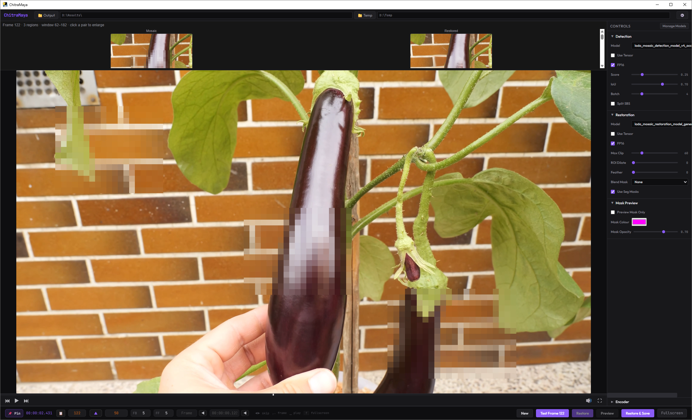
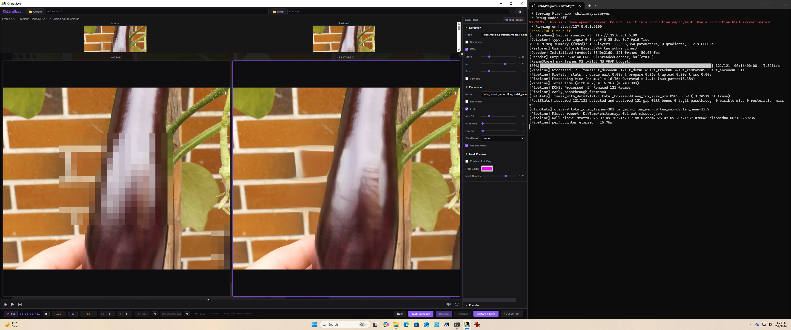
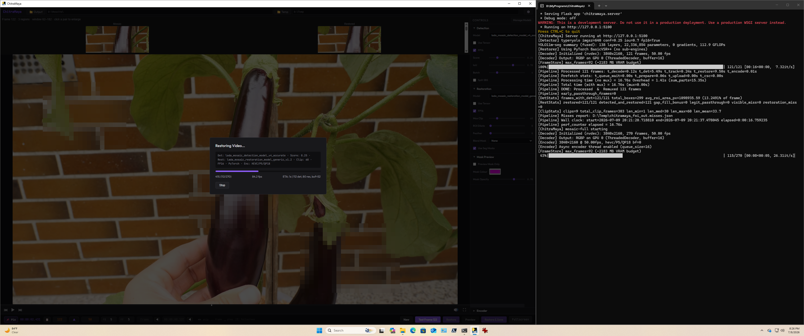

# ChitraMaya

**ChitraMaya is a free, open-source (AGPL-3.0) mosaic restoration tool for Windows that runs on NVIDIA GeForce RTX, AMD Radeon and Intel Arc GPUs.** It finds mosaic-censored regions in video, restores them with the lada / zelefans BasicVSR++ models, and encodes the result on the GPU — with a visual editor to check the restoration on your *actual* frames before spending hours on a full encode, and a folder queue for titles. The NVIDIA edition compiles TensorRT engines for your card; the AMD (ROCm) and Intel Arc (XPU) editions run the same models in PyTorch.

- **Downloads:** <https://get.chitramaya.org> — every file with its SHA-256, and a mainland-China mirror line.
- **User Guide:** [docs/UserGuide.md](docs/UserGuide.md) — installing, models, the workflow, the settings that matter, output files, memory, what to expect from your card, troubleshooting. Installed next to the app as `UserGuide.html` (the **Help** button) and at <https://get.chitramaya.org/userguide.html>.
- **Scaling Guide:** [docs/ScalingGuide.md](docs/ScalingGuide.md) — the Secondary scaler, Output Upscale and custom models, with measurements.
- **Source and issues:** <https://gitlab.com/seatv/chitramaya>. The GitHub repositories (`seatv/ChitraMaya`, `-AMD-ROCM`, `-Intel-ARC`) are mirrors of this one.
- **Changes:** [CHANGELOG.md](CHANGELOG.md).

> [!IMPORTANT]
> ### Which edition do I need? One per GPU vendor — they are separate downloads.
>
> | Your GPU | Installer |
> |---|---|
> | **NVIDIA** GeForce RTX (30/40/50-series) | `ChitraMaya-install.exe` + `.7z.001` + `.7z.002` (all three) |
> | **AMD** Radeon RX 7000 / 9000 (RDNA 3 / 4) | `ChitraMaya-rocm-install.exe` (one file) |
> | **Intel** Arc (A/B-series, Core Ultra iGPU) | `ChitraMaya-xpu-install.exe` (one file) |
>
> The wrong edition tells you so: a startup check probes the GPU before anything else loads and, if this edition cannot run here, shows a message naming the GPUs Windows reports and the edition that matches them. `ChitraMaya-cli.exe -self-check` gives the full verdict. The title bar also says which edition is running.

> [!CAUTION]
> ### ⚠️ The NVIDIA installer is $${\color{red}THREE}$$ files — you need $${\color{red}ALL\ THREE}$$.
>
> The `.exe` **by itself is not the program**; it is only the unpacker for the
> other two parts. Download **all three** into the **same folder**:
>
> - [ ] `ChitraMaya-install.7z.001`
> - [ ] `ChitraMaya-install.7z.002`
> - [ ] `ChitraMaya-install.exe`
>
> *(The AMD and Intel Arc editions are different: each is **one**
> `*-install.exe` you double-click.)*



## Why ChitraMaya?

Some restoration tools are batch processors: set parameters, run a full pass, look at the result, repeat. ChitraMaya is built the other way around — as an **interactive editor** that can also batch.

- **Test a single frame instantly.** Park the playhead on any frame and *Test Frame* restores a short window around it, showing each detected region as **Mosaic → Restored** side by side. Dial a setting, test again, watch it change — the loop is seconds, not a full encode. The enlarged view keeps your **last 5 attempts on that frame**, so you can flip between settings variants with one click and pick the winner by eye.
- **Process a whole folder.** *Process Folder* queues every video in a folder with your current settings — models load once, each file runs isolated (one failure can't kill the batch), finished outputs are skipped on re-run, and existing files are never overwritten.
- **Two-stage restoration quality — on by default.** A second stage — **RTX Super-Res** (NVIDIA) or **Real-ESRGAN 4×** (every edition) — upscales restored regions before paste-back so large close-up regions stop going soft, and a **Temporal Stability** stage removes frame-to-frame shimmer from restored regions. Any super-resolution model from the community can take the second stage's place (drop it into `models\upscalers\`; on NVIDIA, compile it once and it runs twice as fast). See the [Scaling Guide](docs/ScalingGuide.md).
- **Whole-frame upscaling.** **Output Upscale** brings a 720p or 1080p result to 1440p or 2160p as part of the run, or on its own in **Upscale** mode (decode → scale → encode, no models) — Real-ESRGAN on every edition, RTX Super-Res on NVIDIA. It is a clip-and-overnight feature; the [Scaling Guide](docs/ScalingGuide.md) has the measured costs.
- **Live segment preview.** Mark a segment, preview just that range, and decide whether to commit to a full run before encoding the whole video.
- **Hardware-accelerated throughout.** NVDEC decode, TensorRT-accelerated BasicVSR++ restoration, and NVENC encode — to **HEVC, H.264, or AV1** — keep frames on the GPU end to end. (On AMD Radeon: hardware decode and AMF encode with PyTorch restoration; on Intel Arc: Quick Sync decode and encode with PyTorch restoration.)
- **Knows its memory.** A VRAM pre-flight before every run says whether the title fits the card and offers the levers that make it fit; a run report beside every output says what actually ran and where the scanner still suspects mosaic.
- **A clean windowed app.** No terminal window: console output lives in an in-app Console panel and in `ChitraMaya-console.log` next to the exe. (Terminal fans: `ChitraMaya-cli.exe` is the same app with live console output for headless runs and compiles.)
- **Compiles for your GPU.** No models are shipped. **Manage Models** fetches the standard set with one click (**Get Models**) and, on NVIDIA, compiles TensorRT engines *for your specific card* (**Compile Models**) — the header button says which step is next.
- **Made for VR/SBS content.** Per-eye detection for side-by-side video, a runtime **Image Size** dial for dense high-resolution frames, **VR Projection** for studios whose mosaic arrives warped in the raw frame, and **SBS View**: a projected look-around preview (like a headset, on your desktop) with a draggable wipe to compare original vs restored inside the projection.
- **Add Mosaic.** The inverse operation — pixelate regions to produce shareable SFW clips. Draw rectangles by hand (precise, reliable), or let the app auto-detect regions with a detection model (**experimental** — see the warning below).



## Terms & Conditions

By downloading or using this software, in whole or in part, you agree to use it only for purposes that are lawful in your jurisdiction.

You are solely responsible for what you create with it and for complying with all applicable local, regional, and international laws — including, without limitation, those governing privacy, consent, publicity, defamation, and intellectual property. The authors and contributors of this software accept no responsibility and shall not be held liable for any use of the software or for anything produced with it. If you are unsure whether a use is lawful where you are, consult a legal professional before proceeding.

> [!CAUTION]
> **Automatic mosaic detection is experimental and must not be relied on to censor content.** The "Auto-detect" / censor mode uses a third-party NSFW detection model that does **not** reliably find all explicit content — it will miss regions and whole frames. Do not use it to make content safe for publication, distribution, or any purpose where missed content has consequences. For censoring you can trust, use the **manual draw-rectangles** Add Mosaic, apply the two-pass leak check described in the User Guide, and **review every frame of the output yourself** before sharing.

---

## Quick start (users)

1. **Download** the edition for your GPU from <https://get.chitramaya.org> (NVIDIA: all three files into one folder) and run the installer into a **new, empty folder**. Do not extract a new version over an old one.
2. **Models:** start `ChitraMaya.exe`, click the green **Get Models** button, then **Get standard set**.
3. **NVIDIA only — compile:** the button turns amber, **Compile Models**; open Manage Models, *Select all not-compiled*, **Compile** (a few minutes per model, once per card; Image Size 800 if you mostly restore 4K or VR).
4. **Restore:** drag a video in, park on a mosaic frame, **Test Frame**; adjust, test again; **Restore & Save**. The pre-flight dialog tells you if the title fits your card and offers the levers that make it fit.

Everything beyond that — updating with patch zips, the settings that matter, Process Folder, VR and SBS, Add Mosaic, upscaling and custom models, what the output files are, memory, what to expect from your card, and troubleshooting — is in the **[User Guide](docs/UserGuide.md)**. AMD and Intel owners: the guide's requirements and "AMD and Intel in brief" chapters cover what differs (driver versions, Resizable BAR, no compile step).

**Which exe?** `ChitraMaya.exe` is the app — windowed, no terminal; its console output goes to the in-app Console panel and to `ChitraMaya-console.log` next to the exe. `ChitraMaya-cli.exe` is the same app for **terminal workflows** — headless restores and engine compiles in PowerShell, with live output and progress bars (`ChitraMaya-cli.exe -h`).



---

## For Developers

### Prerequisites

- **GPU:** NVIDIA, Turing (RTX 20xx) or newer — or Intel Arc (see below)
- **OS:** Windows 10/11 or Linux
- **Python:** 3.11 or 3.12
- **CUDA:** 12.x with matching cuDNN *(NVIDIA path)*
- **TensorRT:** 10.x *(NVIDIA path)*
- **ffmpeg / ffprobe:** on the system PATH (used for audio remux and decode paths)

### Install from source

```bash
git clone https://gitlab.com/seatv/chitramaya.git
cd ChitraMaya

python -m venv venv
# Windows
venv\Scripts\activate
# Linux
source venv/bin/activate

pip install -r requirements.txt
pip install -e .
```

**Intel Arc source setup:** use `requirements-xpu.txt` instead of `requirements.txt` (it installs the torch `+xpu` wheels and the Intel runtime; do **not** install IPEX — it is discontinued and upstreamed into PyTorch). **AMD ROCm source setup:** use `requirements-rocm.txt` (torch `+rocm` wheels; Adrenalin 26.2.2+ on the target machine). Everything else is identical; the app picks CUDA → XPU/ROCm → CPU automatically at startup.

Models are not shipped; place detection `.pt` and restoration `.pth` files in `models/` (compiled engines are cached in `models/engines/`). The temporal-stability weights are the exception: they live in the repo and ship in the package.

### Compile engines

Compile everything found in `models/` in one shot:

```powershell
# Windows (defaults: DetImgsz 640, DetMaxBatch 8, workspace 2 GB, fp16 on)
powershell -ExecutionPolicy Bypass -File .\Compile-All-Engines.ps1
# Low-VRAM cards, if a compile OOMs:
powershell -ExecutionPolicy Bypass -File .\Compile-All-Engines.ps1 -RestWorkspace 1
```

Or compile individually:

```bash
chitramaya -compile-det  --det-model  models/<detection_model>.pt    --det-imgsz 640
chitramaya -compile-rest --rest-model models/<restoration_model>.pth
chitramaya -compile-sr   4xNomos8k_span_otf_strong.pth --secondary   # custom scaler engines (CM-247)
```

*(v1.60: restoration engines are clip-size independent — `--rest-max-clip-length` is deprecated at compile time and ignored with a note.)*

*(NVIDIA only — the Arc edition runs models directly in PyTorch with no compile step.)*

### Run

```bash
# Interactive UI (default)
chitramaya

# Headless CLI — single file
chitramaya -restore \
    --input video.mp4 \
    --output restored.mp4 \
    --det-model  models/<detection_model>.pt \
    --rest-model models/<restoration_model>.pth \
    --rest-max-clip-length 60 \
    --rest-backend trt \
    --secondary-restoration rtx-2x \
    --temporal-stability 2

# Headless CLI — batch a folder
chitramaya -restore \
    --input D:/videos/incoming \
    --det-model  models/<detection_model>.pt \
    --rest-model models/<restoration_model>.pth \
    --batch-skip-existing
```

Useful CLI flags:

| Flag | Description |
|---|---|
| `--input` | Input video **file**, or a **folder** to batch-process every video in it |
| `--batch-video-extensions` | Comma-separated extensions to include when `--input` is a folder |
| `--batch-skip-existing` / `--no-batch-skip-existing` | Skip files whose output already exists (the resume mechanism; on by default) |
| `--rest-backend` | `auto` (default — uses the compiled TensorRT engines when present, else falls back to PyTorch), `trt` (force TensorRT sub-engines), or `pytorch` (force fallback, no precompiled engines needed) |
| `--rest-max-clip-length` | Frames per restoration clip (30–720 on the Tensor path; engines are clip-size independent as of v1.60). Defaults to 30 if omitted. Longer clips hold more frames in memory — watch the console's RAM-plan line at high values on 4K+/high-fps content. |
| `--restore-chunk-frames` | PyTorch restoration path only: cap the temporal window at N frames (`32` = pre-v1.50 behavior). Default `0` = no cap — the whole clip is restored in one pass. |
| `--det-dump-rois` | Write every detection rectangle per frame into the run's `.misses.json` (for analysis tools like `tools/ab_eval.py`) |
| `--secondary-restoration` | `none`, `rtx-2x`, `rtx-4x`, `esrgan-4x`, or `custom:<file>` — upscale of restored regions before paste-back (the panel defaults to rtx-4x on NVIDIA, esrgan-4x elsewhere) |
| `--temporal-stability` | `0` (off) to `3` — flow-gated temporal smoothing of restored regions (the panel defaults to 1; weights bundled) |
| `--output-upscale` / `--upscale-scaler` | Whole-frame upscale before encode: `2x`, `4x`, `1080p`, `1440p`, `2160p` with `esrgan`, `rtx` (NVIDIA) or `custom:<file>` |
| `--hw-decode` | `auto` (default) or `off` — hardware decode on the ffmpeg lane (AMD / Intel); `CM_HW_DECODE` in the environment overrides |
| `--crop-cap-px` | Store open-scene crops above N px downscaled (0 = off, the default); the 4K-on-8-GB lever |
| `--rest-blendmask` | `none` (default) or `facefusion` — shape-aware Face Swap blend for paste-back edges |
| `--rest-feather-radius` | Feather (px) for the Face Swap blend edge; 0 = auto |
| `--det-conf` | Detection confidence threshold |
| `--det-imgsz` | Detector input size (multiple of 32). Also adjustable in the UI (Detection → Image Size). |
| `--sbs` / `--sbs-det-split` | Side-by-side handling / per-eye detection |
| `--vr-projection` | `none` (default) or `fisheye` — per-eye analysis projection for viewing-space mosaics (requires `--sbs`; see the VR section above) |
| `--async-encoder` | Overlap encode with restoration (opt-in; synchronous is the default). Faster on cards with VRAM headroom. |
| `--enc-codec` | Output codec: `hevc`, `h264`, or `av1` (AV1 needs RTX 40-series or newer NVENC — or QSV on Arc) |
| `--enc-qp` | Encoder quantization parameter, HEVC 0–51 scale (lower = higher quality; mapped internally for AV1) |
| `--mp4-fast-start` / `--no-mp4-fast-start` | Move the MP4 index to the front for streaming (on by default) |
| `--watchdog-stall-seconds` | Stall-watchdog threshold for headless runs (GUI runs: `watchdogStallSeconds` in the config file) |
| `--max-frames` | Process at most N frames (debug) |

Run `chitramaya -restore --help` for the full list. In the packaged app, use `ChitraMaya-cli.exe` for all of the above — the windowed `ChitraMaya.exe` detaches from the terminal and prints nothing there.

### Measure quality (v1.50.00)

`tools/ab_eval.py` is the paired-evaluation harness we use to compare restoration arms (and to keep ourselves honest against other tools). Give it the pristine original, the mosaic'd input, and one or more restored outputs; it aligns the clips automatically (metrics on unaligned clips are garbage — it refuses to make that mistake), masks the analysis to the *restored regions* (run the restore with `--det-dump-rois` so the true detection footprint is in the `.misses.json`), and reports fidelity, texture, motion, and flicker per arm, plus side-by-side renders and a contact sheet. Run `python tools/ab_eval.py --help` from a source checkout.

### Build the installer

```powershell
# From the repo root, in the matching release venv:
# NVIDIA edition:
powershell -ExecutionPolicy Bypass .\packaging\windows\chitramaya-packager.ps1
# Intel Arc edition (from the Arc venv):
powershell -ExecutionPolicy Bypass .\packaging\windows\chitramaya-xpu-packager.ps1
# AMD ROCm edition (from the ROCm venv):
powershell -ExecutionPolicy Bypass .\packaging\windows\chitramaya-rocm-packager.ps1
```

As of v1.50.00 all three packagers share the same behavior: pass **`-FfmpegDir <folder>`** to pin exactly which ffmpeg/ffprobe build gets bundled (otherwise the first one on PATH wins — a field bug once shipped a stray tool's ffmpeg). Each produces **one double-click installer exe** when the build fits under a 2 GB file size (the split keeps every host and mirror happy), or split volumes plus a small shepherd installer exe (which verifies all parts are present, naming any missing file) when it doesn't — the NVIDIA CUDA/TRT stack normally takes the split path. TensorRT builder resources in the NVIDIA build are trimmed to the shipped consumer architectures (plus PTX) to keep the size down — edit `_DROP_TRT_BUILDER_ARCHS` in `packaging\windows\chitramaya.spec` to change which GPUs are supported natively. All three specs verify at build time that every expected module and bundled data file is present and fail loudly naming anything missing; the Arc and ROCm specs additionally refuse to build from the wrong venv and probe the bundled ffmpeg for the hardware encoders they need (QSV / AMF).

---

## Architecture

```
NVIDIA:  Decode (NVDEC) -> [VR Projection] -> Detect (YOLO) -> Track scenes
            -> Restore (BasicVSR++ / TensorRT) -> [Temporal Stability] -> [Secondary: RTX Super-Res | Real-ESRGAN | custom]
            -> Composite -> [Output Upscale: RTX Super-Res | Real-ESRGAN | custom] -> Encode (NVENC)
         (no frame store: a second NVDEC pass re-decodes each frame when it is due)

Intel Arc:  Decode (ffmpeg / Quick Sync) -> [decode guard] -> Detect (YOLO) -> Track scenes
            -> Restore (BasicVSR++ / PyTorch xpu) -> [Temporal Stability] -> [Secondary: Real-ESRGAN | custom]
            -> Composite -> [Output Upscale] -> Encode (ffmpeg / Quick Sync)

AMD ROCm:   Decode (ffmpeg / D3D11VA or CPU) -> [decode guard] -> Detect (YOLO) -> Track scenes
            -> Restore (BasicVSR++ / PyTorch rocm) -> [Temporal Stability, fp32] -> [Secondary: Real-ESRGAN | custom]
            -> Composite -> [Output Upscale] -> Encode (ffmpeg / AMF)
```

A YOLO detector locates mosaic regions per frame, a scene tracker groups them into temporally coherent clips, and a BasicVSR++ restoration model (run through TensorRT sub-engines, or a PyTorch fallback) reconstructs each clip with temporal consistency. Restored regions then pass through two quality stages — a flow-gated **temporal stabilizer** that removes frame-to-frame shimmer, and a **secondary upscale** (RTX Super-Res, Real-ESRGAN or a custom model) so large regions are pasted back without stretching — before being composited into the frame with the **Face Swap** blend that follows the mosaic's actual shape; clips cut by Max Clip overlap and crossfade at the seam. An optional **Output Upscale** then scales the whole frame before encode. At the end of a run the detector looks at the output once more (the **residual scan**) and the run report says what it found. With **VR Projection** enabled, detection through restoration run in a per-eye fisheye space and only the restored regions are warped back, leaving every other pixel of the original untouched.

Full restores stream the whole file through NVDEC for throughput; *Test Frame* and segment previews read just the frames they need. Folder batches keep the whole model stack warm across files and isolate failures per file, with a stall watchdog standing guard.

## Known Issues / Not Yet Implemented

A few things are intentionally incomplete or have known limitations in this release:

- **The Intel Arc and AMD ROCm editions are experimental** — see the User Guide's AMD and Intel chapter. Both run in plain PyTorch (no TensorRT), so expect an RTX-4060-class result on a 9060 XT and a several-times-slower result on Arc; with Resizable BAR off, discrete Arc is ~20× slower.
- **Automatic mosaic detection is experimental — do not rely on it to censor.** The Auto-detect / censor mode depends on a third-party NSFW detection model that does not reliably detect all explicit content; it misses regions and whole frames and is not suitable for production censoring. Use the manual draw-rectangles Add Mosaic with the max-recall settings and two-pass leak check, and review every frame of any output yourself.
- **AMD: damaged frames from the D3D11VA decode path.** A few frames per minute can arrive unfinished from the hardware decoder (black from a row down, or green / magenta). The decode guard completes most of them from the previous frame and the run ends *with warnings*; **Hardware Decode = Off** (Restoration panel) is the sure fix at ~9 % cost. See the AMD section.
- **The RTX Super-Res whole-frame scaler takes its Quality and Denoise from the Secondary's controls.** With the Secondary at ultra + ultra, an Output Upscale pays for a second denoise pass on every 4K frame; set the Secondary's Quality / Denoise to what you want the *upscale* to use, or leave them at the defaults (high / none). Own controls for the Upscale Scaler are planned.
- **A run that delivered zero frames self-grades as complete.** It ends `Processed & Remuxed 0 frames`; the output is empty. Planned: a failure verdict.
- **Three run-time button texts ("Get Models", "Compile Models", "Compile (N selected)") are not yet translated.**
- **On warped-mosaic VR content, run statistics cannot detect a quality failure.** With VR Projection Off on such content, the stats can report full coverage while the output still shows mosaic (the models "restore" blocks they cannot parse). Use **Test Frame** to judge — see the VR section.
- **VR Projection assumes FOV-180 content and requires Split SBS.** Fisheye-native sources with wider lenses (190/200) are handled with the same transform, which has been sufficient in testing; a per-title projection variant is a planned refinement if a title needs it.
- **Detection FP16 applies only to the PyTorch path.** For a compiled TensorRT detection engine, precision is baked in at compile time, so the runtime **Detection FP16** toggle has no effect — the app grays it out when a compiled engine is selected. It still applies to `.pt` PyTorch detection runs.
- **HEVC sources may show a black in-app player.** The player uses the Windows media stack, not the pipeline's decoder. Machines without the **HEVC Video Extensions** (Microsoft Store; free from some OEMs, otherwise $0.99) load and process HEVC fine but show nothing in the player. Install the extension. In-app detection of this case is planned.
- **AMD and Intel editions: the decode and encode transport is the slow stage at 4K.** Frames are decoded and encoded by the GPU but travel through a pipe between ffmpeg and the app — near 30 fps at 1080p60 and ~10 fps at 4K on an RX 9060 XT; on the Arc 140V, 4K *output* runs at about 1 fps. At 1080p the restorer is the slower side and the pipe hides behind it; at 4K it does not. GPU temperature and clocks also read N/A in the bundled monitor on AMD and Intel (load and VRAM work on AMD).
- **4K close-ups on 8 GB cards can still exceed VRAM in scene storage.** The re-decode frame store (v1.80.00, NVIDIA) removed the frame store's cost, and a 2h20m 4K60 title now completes on an 8 GB 3060 Ti; what remains is the open scene's crops on 3,000-px regions. The VRAM preflight dialog names a **Crop Cap** value when a run will not fit and can set it for you before the run starts. It costs some fine texture on the regions it touches.
- **The denoise option after the RTX Super-Res *Secondary* is under review.** Measured on two clips, "ultra" produced output indistinguishable from none at ~60% more restore time. Leave it at none — and note the whole-frame coupling above.
- **Detection debug dumps** — `--debug-save-detection-frames` and `--debug-save-detection-json` still don't write anything.
- **SBS View assumes equirect-180 side-by-side (left|right)** content; fisheye layouts aren't projected correctly yet (a projection selector is planned). Playback in the viewer uses the app's embedded browser decoder, not NVDEC — a very large (8K) HEVC master may not play there even though it restores fine; a downscaled copy will.
- **Add Mosaic rectangles are per-eye for SBS** and are clamped to the eye you drew them in — a rectangle can't span the eye seam. Both eyes receive the mosaic at the same per-eye position (no parallax offset), so pad rectangles generously on close subjects.

Found something else? Please open an issue — **without** attaching any explicit content (see the issue template).

## Acknowledgements

ChitraMaya stands on the work of others, and it's a pleasure to say so:

- **[HypoX64](https://github.com/HypoX64/DeepMosaics)** — author of **DeepMosaics**, where it all began. The first proof that video mosaic restoration was possible at all: [github.com/HypoX64/DeepMosaics](https://github.com/HypoX64/DeepMosaics).
- **[ladaapp](https://codeberg.org/ladaapp/lada)** — author of **lada**. Working with him on the Windows port is what gave me the idea to begin this project, and ChitraMaya uses his excellent detection and restoration models.
- **[Kruk2](https://github.com/kruk2)** — author of **Jasna**. ChitraMaya's BasicVSR++ TensorRT sub-engine implementation (the split of the recurrent network into separately compiled engines, the compile flow, and the runtime orchestration) is ported from Jasna's, as the source file headers note. Three further ideas are Jasna's, re-implemented on ChitraMaya's own tracker and compositor: the Scaler Denoise pass (a second Maxine effect after the upscale), the Overlap + Crossfade at Max Clip cuts (clips overlap, the lead-in is discarded, the seam is faded), and the frame-proportional blend width behind the Face Swap feather's auto setting. Both projects are AGPL-3.0 — the license that makes building on each other's work possible.
- **[zelefans](https://codeberg.org/zelefans/vr_remove_mosaic)** — for the VR mosaic detection models and the fisheye-to-flat projection idea behind ChitraMaya's VR Projection mode.
- **[pifroggi](https://github.com/pifroggi/vs_temporalfix)** — author of **vs_temporalfix**, the flow-gated temporal stabilization model behind ChitraMaya's Temporal Stability feature (Apache-2.0; license included with the bundled weights).
- **[Xintao Wang et al.](https://github.com/xinntao/Real-ESRGAN)** — authors of **Real-ESRGAN** (BSD-3-Clause). The compact `realesr-general-x4v3` model and its SRVGGNetCompact architecture power the all-vendor Real-ESRGAN secondary scaler and the Output Upscale stage; the integration pattern was studied from **[HolyWu's vs-realesrgan](https://github.com/HolyWu/vs-realesrgan)** (BSD-3-Clause). The weights ship with ChitraMaya under their license.
- **[Hanlin Wan et al.](https://github.com/hongyuanyu/SPAN)** — authors of **SPAN** (Swift Parameter-free Attention Network, Apache-2.0), and **[Philip Hofmann (Phhofm)](https://github.com/Phhofm/models)** — trainer of the community super-resolution models, among them `4xNomos8k_span_otf_strong`, which we recommend trying as a secondary scaler on every edition (his models carry their own licences; check the model card). **[spandrel](https://github.com/chaiNNer-org/spandrel)** (MIT, from the chaiNNer project) is what lets ChitraMaya load some forty super-resolution architectures from a bare `.pth` file.
- **NVIDIA Maxine** — the Video Effects SDK powering the RTX Super-Res secondary stage and the RTX whole-frame upscaler.

## License

See [LICENSE](LICENSE) for details.
